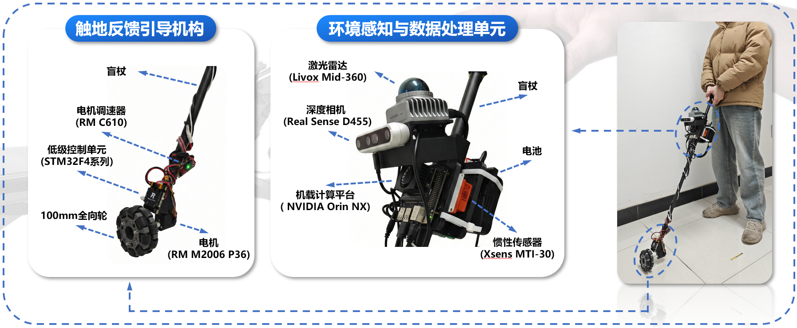
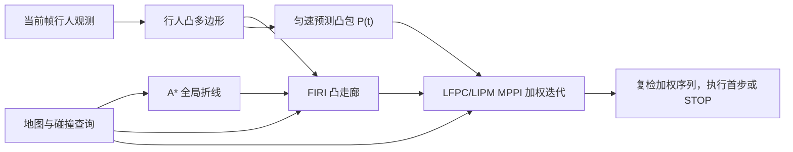
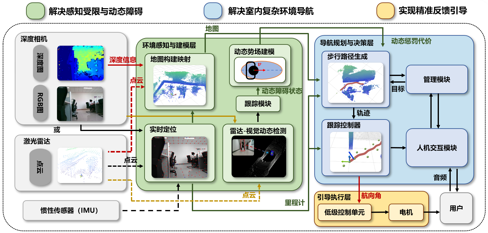
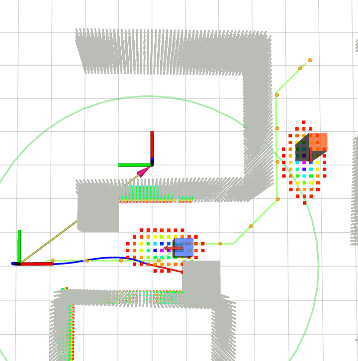
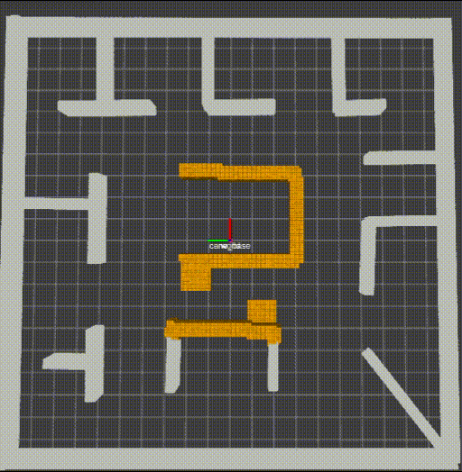
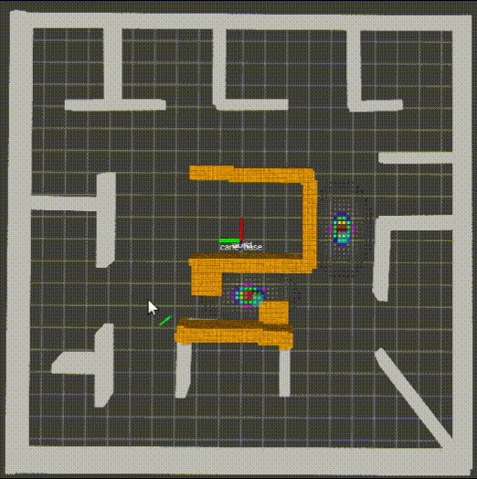
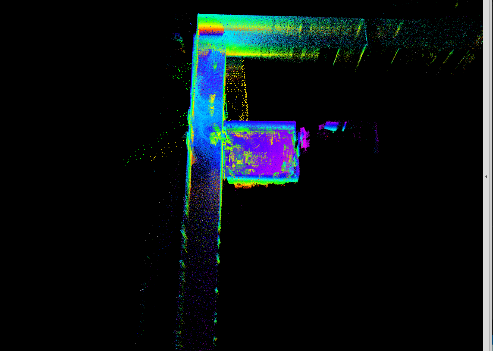
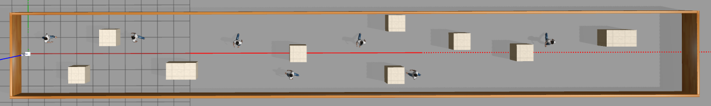
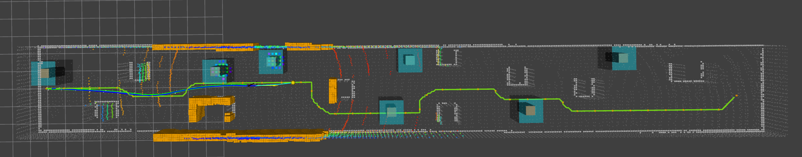
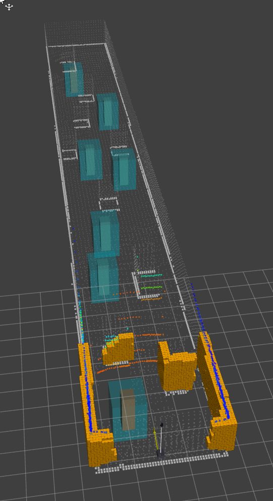

# Cane Planner

`cane_planner` 是面向智能导盲杖的 ROS1 Noetic 导航研究项目。导盲杖由人提供前进运动，系统主要负责转向与路径引导。

**当前开发重点是 `mpc-lfpc-prototype` 分支中的 planner 3：A* 全局路径、FIRI 凸走廊与 LFPC/LIPM MPPI。** 主要验证入口为轻量仿真；仓库同时保留其他规划模式、Gazebo 仿真和早期实机控制接口。

planner 3 通过 MPPI 加权迭代优化连续转向序列，步长与步宽固定。当前实现保留走廊、静态碰撞和时间同步行人碰撞硬约束；早期 DRF-MPPI 的风险场与速度采样不在这条运行路径中。



## 规划模式

四种模式均通过 `kin_replan_node` 和 `PlannerManager` 状态机调度，由 launch 参数 `planner` 选择。

| 参数 | 实现 | 模型与避障方式 |
| --- | --- | --- |
| `planner:=1` | 几何 A* | 二维地图路径搜索，使用地图可通行性查询 |
| `planner:=2` | Kinodynamic A* | 搜索步长、步宽和转角；用 LFPC/LIPM 展开步态，检查质心静态碰撞并加入行人风险场代价与阈值拒绝 |
| **`planner:=3`** | **A* + FIRI + LFPC MPPI** | **固定步长、步宽，优化连续转向序列；静态碰撞、凸走廊空间并集和时间同步行人检查为硬约束** |
| `planner:=4` | 运动学采样控制器 `KinematicMppiController` | A* 航点引导，使用单轮车模型采样线速度、角速度，保留动态风险场、可选 CPA 与交互让行逻辑 |

`sim_kin_replan.launch` 和 `kin_replan.launch` 仍默认选择 planner 2，使用当前主线时需显式传入 `planner:=3`。两个 Gazebo 入口默认选择 planner 3。

## Planner 3 的工作方式



1. **全局参考。** 保留 A* 输出的全部折线顶点，统一用于局部目标选择、投影跟踪、走廊生成和可视化；planner 3 不对它做稀疏航点抽取或圆角平滑。离墙软代价查询同一二维障碍栅格生成的欧氏距离场，在一次搜索内分块复用；每次新搜索读取最新地图。
2. **空间走廊。** FIRI 默认根据当前区域对原始路径的连续覆盖范围推进，排除完整静态栅格与行人凸包，为整个人杖外形预留空间。规划长度默认 8 m，远处预览默认 20 m，两者独立。
3. **转向优化。** 默认预测 10 步，每轮采样 256 条连续转向序列、迭代 2 轮，逐步相对转角限于 `±30°`。在上次解移位后的序列附近施加高斯扰动，按可行序列的代价做指数加权，更新整条序列。步长与步宽固定。
4. **轨迹检查与执行。** 检查落脚点的静态可通行性，以及每个质心采样点的静态碰撞；每个检查姿态的完整人杖包络须包含在某一块凸区域中。启用行人时，另按每个采样点的未来时间，检查机器人包络与匀速预测行人凸包是否相交。选中序列从原始完整 LFPC 状态重新推演，执行前按最新时间原点复查，通过后只执行第一步。
5. **动态路径恢复。** 行人多边形阻断参考路径时，尝试将同一多边形作为临时硬障碍重新跑 A*。新路径须通过走廊重建及观测时效检查，才会替换当前参考。
6. **失败处理。** 加权序列也必须重新通过完整约束检查。若加权结果不可行，保留本轮已验证的可行候选继续迭代；所有加权更新都失败时使用本轮最佳可行候选。无有效走廊、无可行序列或行人数据无效时，发布 STOP 建议；轻量仿真保持 LFPC 状态并发布静止里程计，Gazebo 输出零速度。

加权更新可行时，从初始可行提议和各轮可行加权结果中选择代价最低者，避免相对已验证的热启动解退化。局部目标到达只影响距离代价，仍检查完整预测期；只有安全进入实际最终目标范围才允许提前结束。有限采样 MPPI 提供连续优化过程，**不保证严格局部最优或找到所有可行解**。

### 行人输入与适用范围

- `use_pedestrians:=false` 为静态模式；启用后要求持续收到有效观测。
- 当前 planner 3 支持每帧 **零或一个行人**。新鲜空帧有效；超过一个行人、数组不匹配、非有限数值、无效时间戳或缺失 TF 均视为输入无效。
- 规划坐标系为 `world`。外部观测按原始时间戳变换；默认最大观测与接收时效均为 **0.5 s**，计算结束、执行前仍需检查。
- 行人约束包括**当前帧 FIRI 空间约束 + LFPC 时间同步凸包碰撞检查**。未来凸包按观测速度匀速平移，现有空间走廊仍为必需约束。历史时空走廊与多速度区间鲁棒设计没有接入。
- 默认使用随 LFPC 躯干朝向旋转的完整人杖刚性包络，保留离散姿态与中间转角检查；尚不覆盖采样间连续运动、手杖独立摆动、行人加速度或转向。有限 MPPI 采样没有找到可行序列，不等于证明不存在可行路径。

### LFPC 时间同步避障

对轨迹采样点 `(qᵢ, τᵢ)`，用同一观测帧的凸包 `P₀` 和速度 `v` 预测：

```text
Pᵢ = P₀ + v × [(执行时间原点 − 观测时间戳) + τᵢ]
拒绝条件：机器人包络(qᵢ) 与 Pᵢ 相交或接触
```

`τᵢ` 来自 LFPC 实际积分时刻并跨步累积，Z 坐标仍是高度。保留原有采样截断规则，因此不能用“第几步 × 0.35 s”替代真实采样时间。机器人包络默认覆盖人体圆盘和前方手杖圆盘，并随预测朝向旋转；行人凸包由带独立余量的身体矩形与方向性社会三角形组合。使用按朝向缓存的分离轴（SAT）判断相交，不在搜索内部重复求 FIRI 或社会力。

搜索、选中序列重演、执行前复查使用同一份观测。执行前复查会补偿规划耗时；复查失败发布 `TIMED_EXECUTION_COLLISION`，轻量仿真不推进 LFPC。原有 0.5 s 观测／接收时效限制不变。

原启动命令会默认启用该功能；可追加 `mpc_timed_collision_enable:=false` 做消融，完整人杖尺寸通过 `human_cane_*` 启动参数调整，`mpc_timed_robot_radius` 仅在关闭完整人杖模型的对照模式中生效。RViz 新增 **MPC_TimedCollision**：同色机器人轮廓与行人凸包对应同一未来时刻，颜色由青到紫，文字标注 `+τ s`；STOP 时红色 `Rejected` 表示一个被拒绝的碰撞样本。最多显示十组安全预测，完整采样通过 `/mpc/timed_best_path` 输出，各 `PoseStamped.header.stamp` 为时间原点加 `τᵢ`。

当前 MPPI 的测试、性能与运行证据见 [MPPI 验证记录](docs/LFPC_MPPI_VALIDATION.md)；[时间碰撞检查初版记录](docs/LFPC_TIMED_COLLISION_VALIDATION.md) 保留原 beam 版本的历史结果。

该检查叠加在现有当前帧空间走廊上，所以暂不利用“行人将来离开、机器人稍后再经过”的空间。轻量仿真仍按 FSM 周期整步更新位置，**不连续播放 LFPC 支撑相**；上述时间是预测模型时间，不能据此声称已完成真实执行速度同步或连续运动验证。

具体显示颜色、范围与尺寸调整见 [走廊使用说明](docs/PLANNER3_CORRIDOR_USAGE.md)。

## 编译

使用 ROS1 Noetic、C++14 和 `catkin_tools`。主要原生依赖包括 Eigen、PCL、OpenCV 和 NLopt；FIRI 的 MVIE 优化使用 NLopt。即使只运行静态仿真，编译也需要工作空间中的 `LV-DOT/onboard_detector` 消息包。

以下以工作空间 `~/ws`、仓库位于 `~/ws/src/cane_planner` 为例。从工作空间根目录编译规划包及轻量仿真工具：

```bash
cd ~/ws
source /opt/ros/noetic/setup.bash
catkin build path_searching plan_manage map_generator waypoint_generator \
  -DCMAKE_BUILD_TYPE=Release
source devel/setup.bash
```

每个运行终端都需要加载 ROS 和工作空间环境。Gazebo 定位仿真还依赖同一工作空间中的 `FAST-LIO-SAM-QN`、`FAST-LIO-Localization-QN` 及其 Quatro、Nano-GICP 依赖；pedsim 使用单独部署的可选依赖。

## 轻量仿真

### 静态环境

```bash
roslaunch plan_manage sim_kin_replan.launch planner:=3
```

在 RViz 中按需使用 `2D Pose Estimate` 设置起点，再用 `2D Nav Goal` 发送目标。默认 RViz 配置为 [replan.rviz](plan_manage/config/replan.rviz)，固定坐标系为 `world`。

该模式使用仿真地图输入和 LFPC 状态推进，不需要 Gazebo、FAST-LIO 或实机电机。默认不启用行人。

### 单行人确定性场景

```bash
roslaunch plan_manage sim_kin_replan.launch \
  planner:=3 \
  use_pedestrians:=true \
  pedestrian_scenario:=dwcg_crossing
```

[pedestrian_scenarios.yaml](plan_manage/config/pedestrian_scenarios.yaml) 提供 `dwcg_crossing`、`dwcg_approach`、`dwcg_stationary` 等单行人场景。上述三个场景在收到导航目标后触发；行人按配置运动或保持静止，到达配置时长后退出本次观测。

编译 `plan_manage` 并重新加载工作空间后，同一启动命令会加载 RViz 的 **行人设置** 面板和 **放置行人** 工具（快捷键 `P`）：

1. 选择“放置行人”，在地图上点击起点并拖拽设置行走方向。行人立即作为静止障碍出现，同时预览去程路线与终点。
2. 在面板设置速度、单程时间和结束行为，点击“应用并复位”。速度范围为 `0–10 m/s`，单程时间为 `0.1–3600 s`；速度为零时可放置静止行人。修改面板数值后需要应用，地图预览和运动才会更新。
3. 勾选“收到机器人导航目标后启动”时，用原有 `2D Nav Goal` 设置机器人目标即可启动／重新开始行人运动；不勾选时点击“开始／继续”。放置行人不会设置机器人目标。

| 结束行为 | 运动规则 |
|---|---|
| 终点停止 | 沿放置方向行走 T 秒，在终点保持静止 |
| 终点消失 | 行走 T 秒后退出行人观测 |
| 返回起点后停止 | 去程 T 秒，反向返回 T 秒，在起点保持静止 |
| 持续往返 | 去程、回程各 T 秒，持续重复 |

“暂停”保持当前位置并持续发布零速度观测，“开始／继续”从暂停位置续走；运行中或结束后再点“开始／继续”会从起点重新开始。“复位”回到起点并等待启动，“清除”移除行人并持续发布新鲜空观测。交互控制只支持零或一个行人的确定性场景，不控制 pedsim 或 Gazebo 行人。没有已记忆的配置时，原有 YAML 场景在首次交互前保留其运动方式；旧 `loop` 表示瞬移回起点，旧 `patrol` 的 `period` 表示以起点为中心的完整往返周期。

**默认记住上次配置。** 交互放置、应用或加载成功后会自动保存起点、朝向、速度、时间及结束／触发方式。下次使用同一场景、配置文件和坐标系启动时，自动恢复到配置的起点等待启动；清除后的空场景也会被记住。面板中尚未应用的数值和运行进度不会被恢复。

**直接在面板加载文件。** 点击“保存场景”导出已应用的设置；以后点击“加载场景”，选择 YAML 即可立即恢复配置和地图预览。支持此前由面板导出的文件。加载失败会保留当前行人；新格式带有坐标系信息，坐标系不匹配时会提示错误。

需要固定从指定文件启动时，也可使用以下参数；`pedestrian_remember_last:=false` 表示本次忽略并停止更新自动记忆，直接采用启动文件：

```bash
roslaunch plan_manage sim_kin_replan.launch \
  planner:=3 use_pedestrians:=true \
  pedestrian_scenario:=custom_pedestrian \
  pedestrian_scenario_config:=/absolute/path/pedestrian_custom.yaml \
  pedestrian_remember_last:=false
```

保存的场景加载后在起点等待启动，坐标属于当前仿真坐标系（planner 3 为 `world`）。若面板被关闭，可通过 `Panels → Add New Panel → plan_manage/PedestrianPanel` 加回；工具通过工具栏 `+ → plan_manage/PlacePedestrian` 加回。

中文面板依赖中文字体，包中已声明 `fonts-wqy-microhei` 运行依赖。若源码构建环境显示方框，安装该字体（`sudo apt install fonts-wqy-microhei`）后重启 RViz。

`mixed` 等多行人场景保留给其他模式和历史实验，超出当前 planner 3 的单行人输入范围。确定性行人源、pedsim 桥接、Gazebo 真值桥接与实机检测器应按场景选择一个，避免向同一观测话题发布相互冲突的数据。

### 可选 pedsim 场景

pedsim 用于观察社会力模型下的单行人响应。需先在独立工作空间部署与 [upstream-manifest.json](plan_manage/config/pedsim/upstream-manifest.json) 匹配的补丁版本；普通上游安装或旧补丁版本不能直接替代。

部署说明见 [DEPLOYMENT.txt](plan_manage/config/pedsim/DEPLOYMENT.txt)，场景与整轮操作见 [USAGE.txt](plan_manage/config/pedsim/USAGE.txt)。入口脚本目前含本机工作空间路径，换环境时需先对齐脚本中的路径与依赖。

```bash
bash "$(rospack find plan_manage)/scripts/start_pedsim_navigation.sh" \
  start --scenario crossing
```

支持 `headon`、`overtake`、`crossing`。脚本生成场景并启动 planner 3、pedsim 和桥接，使用独立 ROS master，默认端口 `11551`。人的起点、目标和相遇时机仍由 RViz 操作决定。

桥接等待导航目标和新鲜 LFPC 里程计后自动启动行人。`FAULT_RESTART_ROUND` 表示当前轮次已锁定故障，需在该入口终端用 Ctrl+C 结束整轮再重新启动；恢复输入或手动 unpause 不会清除故障。状态话题为 `/pedsim_single_bridge/status` 和 `/pedsim_simulator/guard_status`，在该轮次的 master 上查看。

## Gazebo 与重定位仿真

在已经编译并加载定位工作空间环境后，分别在两个终端运行：

```bash
# 终端 1：Gazebo、planner 3 与 RViz
roslaunch plan_manage gazebo_localization_mpc.launch \
  planner:=3 gui:=true rviz:=true start_teleop:=false
```

```bash
# 终端 2：FAST-LIO 与地图重定位
roslaunch fast_lio_localization_qn sim_corridor_175_fastlio.launch rviz:=false
```

定位输出 `/localization_odom` 和 `/corrected_current_pcd` 后，再在 RViz 发送目标。规划器用定位位姿重锚定 LFPC，并通过 `/cmd_vel_footprint` 输出前进速度与角速度，模拟人的推行和导盲杖转向。

`gazebo_localization_mpc.launch` 默认加载保存的 PCD 作为全局静态地图，局部 SDF 接收定位后的点云。地图路径可用 `static_map_pcd` 覆盖；默认文件依赖配套 FAST-LIO 工作空间。

planner 3 下两个 Gazebo 入口默认关闭行人。仓库自带动态世界含多个行人，超出当前单行人范围；启用行人时还需提供匹配的有效观测源，单独打开动态世界不能代替观测输入。

## 实机接口现状

现有实机入口仍以 planner 1、2 的 L1 路径跟踪为基础，例如：

```bash
roslaunch plan_manage kin_replan.launch planner:=2
```

该入口会启动 RealSense、Livox 驱动和 Faster-LIO，需另外部署 `realsense2_camera`、`livox_ros_driver2`、`faster_lio`。实际传感器、串口及 TF 配置需与设备一致；启用行人时还需要单独运行有效检测源。

**planner 3 的实机控制链尚未接通。** 当前 `L1_controller_v2` 只为 planner 1、2 订阅路径，未订阅 planner 3 的局部控制路径或 STOP 建议；非 Gazebo 的 planner 3 仍包含仿真式状态推进。`/mpc/path` 是累积轨迹，`/mpc/best_traj` 是可视化 Marker，均不是已经接入 L1 的滚动控制路径。

待完成内容包括真实里程计重锚定、局部控制路径发布、L1 订阅、STOP 接入和串口输出处理。现有 [实机接入计划](docs/PLANNER3_MPC_REAL_HARDWARE_PLAN.md) 与 [L1 自适应前瞻方案](docs/MPC_L1_ADAPTIVE_LOOKAHEAD_PLAN.md) 可作为设计背景，其中旧 MPPI 参数和部分状态描述需按当前代码核对。

## Planner 3 参数

公共配置在 [algorithm.launch](plan_manage/launch/include/algorithm.launch)。下表为当前 launch 加载值，参数位于 `/kin_replan_node/` 私有命名空间；直接使用 C++ 缺省值时可能不同。

| 参数 | 当前值 | 含义 |
| --- | --- | --- |
| `mpc/horizon_steps` | `10` | 预测步数 |
| `mpc/num_samples` | `256` | 每轮序列数，可由启动参数 `mpc_num_samples` 覆盖 |
| `mpc/mpc_iters` | `2` | 加权优化迭代轮数 |
| `mpc/temperature` | `0.4` | 指数权重温度；越小越偏向低代价样本 |
| `mpc/sigma_api` | `0.35 rad` | 连续转角高斯扰动标准差，兼顾冷启动转弯探索 |
| `mpc/max_api` | `π/6 rad` | 每步相对转角上限，约 30° |
| `mpc/random_seed` | `0` | 初始化随机种子；运行中不逐周期重新播种 |
| `mpc/timed_collision_enable` | `true` | 行人未来凸包与机器人包络的时间同步 SAT 硬检查；关闭用于消融 |
| `mpc/timed_robot_radius` | `0.25 m` | 关闭完整人杖时的质心包络半径 |
| `mpc/nominal_al` | `0.40 m` | 固定步长参数，由 launch 参数 `user_step_length` 提供 |
| `mpc/nominal_aw` | `0.0 m` | 固定步宽参数 |
| `lfpc/t_sup` | `0.35 s` | 单支撑相持续时间 |
| `lfpc/delta_t` | `0.07 s` | 单步内质心采样间隔 |
| `mpc/w_goal` | `25.0` | 局部目标距离代价权重 |
| `mpc/w_steer` | `0.5` | 转角幅度代价权重 |
| `mpc/w_dapi` | `0.2` | 相邻步转角变化代价权重 |
| `manager/lookahead_dist` | `3.0 m` | 沿全局参考选择局部目标的前瞻距离 |
| `convex_corridor/local_radius` | `3.0 m` | 走廊局部地图查询与扩展范围参数 |
| `convex_corridor/max_segment_length` | `1.0 m` | 自适应模式的前向保护长度上限；旧模式的最大分段长度 |
| `convex_corridor/adaptive_sampling` | `true` | 根据连续覆盖范围推进生成位置 |
| `convex_corridor/planning_length` | `8.0 m` | 实际规划参考长度 |
| `convex_corridor/preview_length` | `20.0 m` | 远处预览长度，0 为剩余整条路线 |
| `human_cane/enabled` | `true` | 完整人杖刚性包络 |
| `human_cane/body_radius`、`cane_length`、`front_radius`、`margin` | `0.25/0.65/0.12/0.03 m` | 人体半径、前伸距离、前端半径和余量 |
| `astar/w_clearance` | `1.0` | A* 离障碍距离的软偏好权重 |
| `astar/clearance_sigma` | `0.8 m` | A* 偏好的额外离障碍距离范围 |

预测步数支持 `1..32`，每轮序列数 `1..4096`，迭代次数 `1..16`；温度须为有限正数，扰动幅度须为有限非负数。每轮保留当前提议与本周期最佳可行序列两个槽位，其余使用成对正负高斯扰动；序列数小于 3 时没有随机探索。参数在节点初始化时读取。

planner 3 始终固定步长、步宽，只优化转角；`sigma_al`、`sigma_aw`、`fix_step_params`、`use_best` 不控制它。原 `beam_width` 已移除。DRF、CPA 与交互让行参数主要保留给 planner 4；planner 3 的走廊和无效结果 STOP 为强制逻辑。

## 话题与调试

| 话题 | 类型 | 用途 |
| --- | --- | --- |
| `/move_base_simple/goal` | `geometry_msgs/PoseStamped` | RViz 导航目标 |
| `/onboard_detector/dynamic_obstacles_info` | `onboard_detector/DynamicObstacles` | 行人位置、速度、完整尺寸及观测头信息 |
| `/astar/path` | `nav_msgs/Path` | 全局参考路径 |
| `/mpc/convex_corridor` | `visualization_msgs/MarkerArray` | FIRI 走廊及 planner 3 行人多边形可视化 |
| `/mpc/corridor_preview` | `visualization_msgs/MarkerArray` | 浅色远处预览，不能授权运动或触发 STOP |
| `/mpc/human_cane` | `visualization_msgs/MarkerArray` | 当前及选中轨迹上的完整人杖外形 |
| `/mpc/convex_corridor_debug` | `std_msgs/String` | 走廊可行性、失败原因和路径恢复诊断 |
| `/mpc/best_traj` | `visualization_msgs/Marker` | 当前选中的预测轨迹 |
| `/mpc/timed_best_path` | `nav_msgs/Path` | 带未来时间戳的选中轨迹；无有效动态预测时为空 |
| `/mpc/timed_collision` | `visualization_msgs/MarkerArray` | 同时刻机器人包络、匀速预测行人凸包及冲突样本 |
| `/mpc/path` | `nav_msgs/Path` | 累积轨迹历史 |
| `/mpc/sample_trajectories` | `visualization_msgs/MarkerArray` | 最后一轮的有界采样显示；青色可行、橙色拒绝 |
| `/mpc/optimization_evidence` | `std_msgs/Float64MultiArray` | 采样数、加权复检、有效样本量、逐轮代价及重演结果 |
| `/mpc/debug_metrics` | `std_msgs/Float64MultiArray` | 规划耗时、拒绝计数和执行代价 |
| `/mpc/transaction_diagnostics` | `std_msgs/Float64MultiArray` | 观测时效、事务耗时及是否执行 LFPC 积分 |
| `/mpc/stop_advice`、`/mpc/stop_reason` | `std_msgs/Bool`、`std_msgs/String` | 停止建议及原因 |
| `/sim_odom` | `nav_msgs/Odometry` | 轻量仿真的 LFPC 状态与静止心跳 |
| `/cmd_vel_footprint` | `geometry_msgs/Twist` | Gazebo 模式下的速度输出 |

`/mpc/debug_metrics` 保留原有 0–25 索引，5 为动态拒绝数，19 为仅空间模式标志；新增 26=时间检查启用且有行人，27=时间检查点数，28=已执行时间原点复查，29=复查安全。距离和 CPA 指标仍为 `-1`，SAT 相交结果不冒充欧氏距离。

MPPI 模式下，索引 1 为全部采样中的可行比例，7 为实际采样总数，16/17 为可行采样数，20/21 为加权检查／全轮加权失败后回退标志；拒绝计数包含加权检查与重演，不是独立轨迹数。索引 2 是本轮所有已验证候选的最低代价，22 是实际执行序列代价，两者可能不同。`optimization_evidence` 的 0–13 为固定头，随后依次为各轮最低已验证代价、各轮加权结果代价；`-1` 表示不可用。最低代价曲线非增只表示保留了最佳候选，不是最优性证明；执行前时效与碰撞复查仍以 STOP 和索引 28/29 为准。

里程计和点云输入由 launch remap 决定：轻量仿真使用仿真生成器；FAST-LIO 使用 `/Odometry`、`/cloud_registered`；重定位入口使用 `/localization_odom`、`/corrected_current_pcd`。

STOP 时先检查 `/mpc/stop_reason`，再查看 `/mpc/convex_corridor_debug`。常见原因有 `DYNAMIC_DATA_INVALID`、`DYNAMIC_REFERENCE_BLOCKED`、`INVALID_STATIC_CORRIDOR` 和 `NO_FEASIBLE_TRAJECTORY`。`Float64MultiArray` 的字段含义应按消息的 `layout.dim[].label` 和发布代码读取；采样可行比例不是碰撞概率。

轻量仿真录包：

```bash
rosrun plan_manage record_lightweight_mpc_eval.sh planner3_trial
```

pedsim 独立轮次使用配套入口的 `record` 子命令，以连接正确的 master：

```bash
bash "$(rospack find plan_manage)/scripts/start_pedsim_navigation.sh" \
  record --label planner3_pedsim_trial
```

## 测试与静态失败回放

从工作空间根目录构建并运行已注册的 C++ 测试：

```bash
catkin build path_searching plan_manage --no-deps --catkin-make-args tests
catkin test path_searching plan_manage
catkin_test_results build/path_searching
catkin_test_results build/plan_manage
```

测试覆盖 A* 边碰撞、FIRI 几何、MVIE 数值情况、行人多边形、MPPI 连续优化、加权复检、热启动、轨迹与代价，以及 manager 的 STOP、里程计心跳和观测事务等。测试通过与实际导航场景验证需分别记录。

planner 3 会记录每个目标的首个符合条件的静态走廊失败快照，保存路径见运行日志。使用同一生成器回放：

```bash
rosrun path_searching convex_corridor_replay /path/to/failure.snapshot
```

当前快照回放仅覆盖静态输入；动态行人几何的精确运行时回放尚未实现。

## 代码与文档入口

| 路径 | 职责 |
| --- | --- |
| [planner_manager.cpp](plan_manage/src/planner_manager.cpp) | 状态机、全局路径、行人事务、走廊恢复与执行 |
| [mpc_controller.cpp](path_searching/src/mpc_controller.cpp) | planner 3 的 LFPC MPPI 连续转向优化 |
| [convex_corridor.cpp](path_searching/src/convex_corridor.cpp) | FIRI 几何分离、MVIE 与走廊证书 |
| [pedestrian_polygon.cpp](path_searching/src/pedestrian_polygon.cpp) | 当前帧行人凸多边形 |
| [lfpc.cpp](path_searching/src/lfpc.cpp) | LFPC 落脚控制与 LIPM 状态推演 |
| `plan_env/` | 局部 SDF/ESDF、静态地图后端和碰撞查询 |
| `plan_manage/launch/`、`plan_manage/config/` | 场景入口、参数与 RViz 配置 |
| `plan_ctrl/`、`plan_ctrl2/`、`omniGKF_ctrl/` | 路径跟踪与硬件接口 |
| `bspline/`、`bspline_opt/` | B 样条表示与优化；当前 planner 2 已关闭拟合调用 |
| `Utils/`、`LFPC/` | 地图与硬件工具、Python 步态参考原型 |

当前运行约定见 [.trellis/spec/planning-runtime/](.trellis/spec/planning-runtime/index.md)，重点是 [静态 FIRI](.trellis/spec/planning-runtime/static-firi-corridor.md) 和 [当前帧行人走廊](.trellis/spec/planning-runtime/current-frame-pedestrian-corridor.md)。FIRI 改编代码的来源与许可见 [FIRI_NOTICE](path_searching/FIRI_NOTICE)。

`docs/archive/`、`docs/superpowers/` 和 [混合场景调试记录](docs/MIXED_CORRIDOR_DEBUG_NOTES.md) 保留历史方案与实验记录；其中的 DRF-MPPI、时空走廊、旧参数和验证结果不能直接作为当前 planner 3 的运行说明。

<details>
<summary>早期系统图与实验展示</summary>

以下图片和动画记录较早版本，用于展示硬件、定位与实验场景；算法名称和交互行为以本文当前实现说明为准。










</details>
