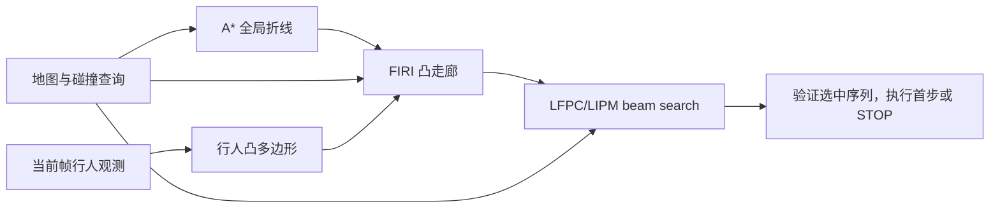

# Cane Planner

`cane_planner` 是面向智能导盲杖的 ROS1 Noetic 导航研究项目。导盲杖由人提供前进运动，系统主要负责转向与路径引导。

**当前开发重点是 `mpc-lfpc-prototype` 分支中的 planner 3：A* 全局路径、FIRI 凸走廊与 LFPC/LIPM beam search。** 主要验证入口为轻量仿真；仓库同时保留其他规划模式、Gazebo 仿真和早期实机控制接口。

代码中的 `MpcController` 类名、`mpc/*` 参数及 `/mpc/*` 话题沿用历史命名。planner 3 当前已经使用离散 beam search，早期 DRF-MPPI 的算法介绍和调参方式不适用于这条运行路径。


## 规划模式

四种模式均通过 `kin_replan_node` 和 `PlannerManager` 状态机调度，由 launch 参数 `planner` 选择。

| 参数 | 实现 | 模型与避障方式 |
| --- | --- | --- |
| `planner:=1` | 几何 A* | 二维地图路径搜索，使用地图可通行性查询 |
| `planner:=2` | Kinodynamic A* | 搜索步长、步宽和转角；用 LFPC/LIPM 展开步态，检查质心静态碰撞并加入行人风险场代价与阈值拒绝 |
| **`planner:=3`** | **A* + FIRI + LFPC beam search** | **固定步长、步宽，搜索转向序列；静态碰撞和凸走廊空间并集为硬约束** |
| `planner:=4` | 运动学采样控制器 `KinematicMppiController` | A* 航点引导，使用单轮车模型采样线速度、角速度，保留动态风险场、可选 CPA 与交互让行逻辑 |

`sim_kin_replan.launch` 和 `kin_replan.launch` 仍默认选择 planner 2，使用当前主线时需显式传入 `planner:=3`。两个 Gazebo 入口默认选择 planner 3。

## Planner 3 的工作方式



1. **全局参考。** 保留 A* 输出的全部折线顶点，统一用于局部目标选择、投影跟踪、走廊生成和可视化；planner 3 不对它做稀疏航点抽取或圆角平滑。
2. **空间走廊。** FIRI 沿局部参考路径生成相邻凸区域，排除完整静态障碍栅格。启用行人后，将当前观测构造为凸多边形，用同一套 FIRI 分离约束排除。
3. **步态搜索。** 每步枚举相对转角 `[-30°, -15°, 0°, 15°, 30°]`，分别为各首步方向保留 beam 候选。当前 launch 配置预测 10 步、每个首步方向最多保留 8 个候选，步长与步宽固定。
4. **轨迹检查与执行。** 检查落脚点的静态可通行性，以及每个质心采样点的静态碰撞和走廊并集包含关系。选中序列从原始完整 LFPC 状态重新推演，通过后只执行第一步，再进入下一轮规划。
5. **动态路径恢复。** 行人多边形阻断参考路径时，尝试将同一多边形作为临时硬障碍重新跑 A*。新路径须通过走廊重建及观测时效检查，才会替换当前参考。
6. **失败处理。** 无有效走廊、无可行搜索结果或行人数据无效时，发布 STOP 建议；轻量仿真保持 LFPC 状态并发布静止里程计，Gazebo 输出零速度。

### 行人输入与适用范围

- `use_pedestrians:=false` 为静态模式；启用后要求持续收到有效观测。
- 当前 planner 3 支持每帧 **零或一个行人**。新鲜空帧有效；超过一个行人、数组不匹配、非有限数值、无效时间戳或缺失 TF 均视为输入无效。
- 规划坐标系为 `world`。外部观测按原始时间戳变换；默认最大观测与接收时效均为 **0.5 s**，计算结束、执行前仍需检查。
- 行人约束是**当前帧空间几何约束**。速度与局部排斥力参与多边形构造，当前路径未启用历史设计中的时空走廊或多速度区间鲁棒检查。
- 碰撞检查覆盖落脚点及离散质心点，尚不构成完整人杖外形或未来行人运动的安全证明。有限 beam 搜索未找到延伸，也不等于证明不存在可行路径。

## 编译

使用 ROS1 Noetic、C++14 和 `catkin_tools`。主要原生依赖包括 Eigen、PCL、OpenCV 和 NLopt；FIRI 的 MVIE 优化使用 NLopt。即使只运行静态仿真，编译也需要工作空间中的 `LV-DOT/onboard_detector` 消息包。

以下以工作空间 `~/ws`、仓库位于 `~/ws/src/cane_planner` 为例。从工作空间根目录编译规划包及轻量仿真工具：

```bash
cd ~/ws
source /opt/ros/noetic/setup.bash
catkin build path_searching plan_manage map_generator waypoint_generator \
  -DCMAKE_BUILD_TYPE=Release
source devel/setup.bash
```

每个运行终端都需要加载 ROS 和工作空间环境。Gazebo 定位仿真还依赖同一工作空间中的 `FAST-LIO-SAM-QN`、`FAST-LIO-Localization-QN` 及其 Quatro、Nano-GICP 依赖；pedsim 使用单独部署的可选依赖。

## 轻量仿真

### 静态环境

```bash
roslaunch plan_manage sim_kin_replan.launch planner:=3
```

在 RViz 中按需使用 `2D Pose Estimate` 设置起点，再用 `2D Nav Goal` 发送目标。默认 RViz 配置为 [replan.rviz](plan_manage/config/replan.rviz)，固定坐标系为 `world`。

该模式使用仿真地图输入和 LFPC 状态推进，不需要 Gazebo、FAST-LIO 或实机电机。默认不启用行人。

### 单行人确定性场景

```bash
roslaunch plan_manage sim_kin_replan.launch \
  planner:=3 \
  use_pedestrians:=true \
  pedestrian_scenario:=dwcg_crossing
```

[pedestrian_scenarios.yaml](plan_manage/config/pedestrian_scenarios.yaml) 提供 `dwcg_crossing`、`dwcg_approach`、`dwcg_stationary` 等单行人场景。上述三个场景在收到导航目标后触发；行人按配置运动或保持静止，到达配置时长后退出本次观测。

`mixed` 等多行人场景保留给其他模式和历史实验，超出当前 planner 3 的单行人输入范围。确定性行人源、pedsim 桥接、Gazebo 真值桥接与实机检测器应按场景选择一个，避免向同一观测话题发布相互冲突的数据。

### 可选 pedsim 场景

pedsim 用于观察社会力模型下的单行人响应。需先在独立工作空间部署与 [upstream-manifest.json](plan_manage/config/pedsim/upstream-manifest.json) 匹配的补丁版本；普通上游安装或旧补丁版本不能直接替代。

部署说明见 [DEPLOYMENT.txt](plan_manage/config/pedsim/DEPLOYMENT.txt)，场景与整轮操作见 [USAGE.txt](plan_manage/config/pedsim/USAGE.txt)。入口脚本目前含本机工作空间路径，换环境时需先对齐脚本中的路径与依赖。

```bash
bash "$(rospack find plan_manage)/scripts/start_pedsim_navigation.sh" \
  start --scenario crossing
```

支持 `headon`、`overtake`、`crossing`。脚本生成场景并启动 planner 3、pedsim 和桥接，使用独立 ROS master，默认端口 `11551`。人的起点、目标和相遇时机仍由 RViz 操作决定。

桥接等待导航目标和新鲜 LFPC 里程计后自动启动行人。`FAULT_RESTART_ROUND` 表示当前轮次已锁定故障，需在该入口终端用 Ctrl+C 结束整轮再重新启动；恢复输入或手动 unpause 不会清除故障。状态话题为 `/pedsim_single_bridge/status` 和 `/pedsim_simulator/guard_status`，在该轮次的 master 上查看。

## Gazebo 与重定位仿真

在已经编译并加载定位工作空间环境后，分别在两个终端运行：

```bash
# 终端 1：Gazebo、planner 3 与 RViz
roslaunch plan_manage gazebo_localization_mpc.launch \
  planner:=3 gui:=true rviz:=true start_teleop:=false
```

```bash
# 终端 2：FAST-LIO 与地图重定位
roslaunch fast_lio_localization_qn sim_corridor_175_fastlio.launch rviz:=false
```

定位输出 `/localization_odom` 和 `/corrected_current_pcd` 后，再在 RViz 发送目标。规划器用定位位姿重锚定 LFPC，并通过 `/cmd_vel_footprint` 输出前进速度与角速度，模拟人的推行和导盲杖转向。

`gazebo_localization_mpc.launch` 默认加载保存的 PCD 作为全局静态地图，局部 SDF 接收定位后的点云。地图路径可用 `static_map_pcd` 覆盖；默认文件依赖配套 FAST-LIO 工作空间。

planner 3 下两个 Gazebo 入口默认关闭行人。仓库自带动态世界含多个行人，超出当前单行人范围；启用行人时还需提供匹配的有效观测源，单独打开动态世界不能代替观测输入。

## 实机接口现状

现有实机入口仍以 planner 1、2 的 L1 路径跟踪为基础，例如：

```bash
roslaunch plan_manage kin_replan.launch planner:=2
```

该入口会启动 RealSense、Livox 驱动和 Faster-LIO，需另外部署 `realsense2_camera`、`livox_ros_driver2`、`faster_lio`。实际传感器、串口及 TF 配置需与设备一致；启用行人时还需要单独运行有效检测源。

**planner 3 的实机控制链尚未接通。** 当前 `L1_controller_v2` 只为 planner 1、2 订阅路径，未订阅 planner 3 的局部控制路径或 STOP 建议；非 Gazebo 的 planner 3 仍包含仿真式状态推进。`/mpc/path` 是累积轨迹，`/mpc/best_traj` 是可视化 Marker，均不是已经接入 L1 的滚动控制路径。

待完成内容包括真实里程计重锚定、局部控制路径发布、L1 订阅、STOP 接入和串口输出处理。现有 [实机接入计划](docs/PLANNER3_MPC_REAL_HARDWARE_PLAN.md) 与 [L1 自适应前瞻方案](docs/MPC_L1_ADAPTIVE_LOOKAHEAD_PLAN.md) 可作为设计背景，其中旧 MPPI 参数和部分状态描述需按当前代码核对。

## Planner 3 参数

公共配置在 [algorithm.launch](plan_manage/launch/include/algorithm.launch)。下表为当前 launch 加载值，参数位于 `/kin_replan_node/` 私有命名空间；直接使用 C++ 缺省值时可能不同。

| 参数 | 当前值 | 含义 |
| --- | --- | --- |
| `mpc/horizon_steps` | `10` | 搜索预测步数 |
| `mpc/beam_width` | `8` | 每个首步方向的 beam 保留宽度 |
| `mpc/nominal_al` | `0.40 m` | 固定步长参数，由 launch 参数 `user_step_length` 提供 |
| `mpc/nominal_aw` | `0.0 m` | 固定步宽参数 |
| `lfpc/t_sup` | `0.35 s` | 单支撑相持续时间 |
| `lfpc/delta_t` | `0.07 s` | 单步内质心采样间隔 |
| `mpc/w_goal` | `25.0` | 局部目标距离代价权重 |
| `mpc/w_steer` | `0.5` | 转角幅度代价权重 |
| `mpc/w_dapi` | `0.2` | 相邻步转角变化代价权重 |
| `manager/lookahead_dist` | `3.0 m` | 沿全局参考选择局部目标的前瞻距离 |
| `convex_corridor/local_radius` | `3.0 m` | 走廊局部地图查询与扩展范围参数 |
| `convex_corridor/max_segment_length` | `1.0 m` | 原始参考边的最大分段长度 |
| `astar/w_clearance` | `1.0` | A* 离障碍距离的软偏好权重 |
| `astar/clearance_sigma` | `0.8 m` | A* 偏好的额外离障碍距离范围 |

beam 宽度和预测步数均支持 `1..32`。配置中的最大转角用于筛选上述五个离散动作，不会生成额外转角。

`mpc/num_samples`、温度、噪声幅度、`use_best` 等随机 MPPI 设置不再被 planner 3 使用。DRF、CPA 与交互让行参数主要保留给 planner 4；planner 3 的走廊和无效结果 STOP 为强制逻辑。

## 话题与调试

| 话题 | 类型 | 用途 |
| --- | --- | --- |
| `/move_base_simple/goal` | `geometry_msgs/PoseStamped` | RViz 导航目标 |
| `/onboard_detector/dynamic_obstacles_info` | `onboard_detector/DynamicObstacles` | 行人位置、速度、完整尺寸及观测头信息 |
| `/astar/path` | `nav_msgs/Path` | 全局参考路径 |
| `/mpc/convex_corridor` | `visualization_msgs/MarkerArray` | FIRI 走廊及 planner 3 行人多边形可视化 |
| `/mpc/convex_corridor_debug` | `std_msgs/String` | 走廊可行性、失败原因和路径恢复诊断 |
| `/mpc/best_traj` | `visualization_msgs/Marker` | 当前选中的预测轨迹 |
| `/mpc/path` | `nav_msgs/Path` | 累积轨迹历史 |
| `/mpc/beam_evidence` | `std_msgs/Float64MultiArray` | 各首步方向、剪枝、完整延伸及选中分支证据 |
| `/mpc/debug_metrics` | `std_msgs/Float64MultiArray` | 规划耗时、拒绝计数和执行代价 |
| `/mpc/transaction_diagnostics` | `std_msgs/Float64MultiArray` | 观测时效、事务耗时及是否执行 LFPC 积分 |
| `/mpc/stop_advice`、`/mpc/stop_reason` | `std_msgs/Bool`、`std_msgs/String` | 停止建议及原因 |
| `/sim_odom` | `nav_msgs/Odometry` | 轻量仿真的 LFPC 状态与静止心跳 |
| `/cmd_vel_footprint` | `geometry_msgs/Twist` | Gazebo 模式下的速度输出 |

里程计和点云输入由 launch remap 决定：轻量仿真使用仿真生成器；FAST-LIO 使用 `/Odometry`、`/cloud_registered`；重定位入口使用 `/localization_odom`、`/corrected_current_pcd`。

STOP 时先检查 `/mpc/stop_reason`，再查看 `/mpc/convex_corridor_debug`。常见原因有 `DYNAMIC_DATA_INVALID`、`DYNAMIC_REFERENCE_BLOCKED`、`INVALID_STATIC_CORRIDOR` 和 `NO_FEASIBLE_TRAJECTORY`。`Float64MultiArray` 的字段含义应按消息的 `layout.dim[].label` 和发布代码读取；beam 统计中的展开边数、完整叶节点数不能当作旧 MPPI 的采样成功率。

轻量仿真录包：

```bash
rosrun plan_manage record_lightweight_mpc_eval.sh planner3_trial
```

pedsim 独立轮次使用配套入口的 `record` 子命令，以连接正确的 master：

```bash
bash "$(rospack find plan_manage)/scripts/start_pedsim_navigation.sh" \
  record --label planner3_pedsim_trial
```

## 测试与静态失败回放

从工作空间根目录构建并运行已注册的 C++ 测试：

```bash
catkin build path_searching plan_manage --no-deps --catkin-make-args tests
catkin test path_searching plan_manage
catkin_test_results build/path_searching
catkin_test_results build/plan_manage
```

测试覆盖 A* 边碰撞、FIRI 几何、MVIE 数值情况、行人多边形、beam 轨迹与代价，以及 manager 的 STOP、里程计心跳和观测事务等。测试通过与实际导航场景验证需分别记录。

planner 3 会记录每个目标的首个符合条件的静态走廊失败快照，保存路径见运行日志。使用同一生成器回放：

```bash
rosrun path_searching convex_corridor_replay /path/to/failure.snapshot
```

当前快照回放仅覆盖静态输入；动态行人几何的精确运行时回放尚未实现。

## 代码与文档入口

| 路径 | 职责 |
| --- | --- |
| [planner_manager.cpp](plan_manage/src/planner_manager.cpp) | 状态机、全局路径、行人事务、走廊恢复与执行 |
| [mpc_controller.cpp](path_searching/src/mpc_controller.cpp) | planner 3 的 LFPC beam search |
| [convex_corridor.cpp](path_searching/src/convex_corridor.cpp) | FIRI 几何分离、MVIE 与走廊证书 |
| [pedestrian_polygon.cpp](path_searching/src/pedestrian_polygon.cpp) | 当前帧行人凸多边形 |
| [lfpc.cpp](path_searching/src/lfpc.cpp) | LFPC 落脚控制与 LIPM 状态推演 |
| `plan_env/` | 局部 SDF/ESDF、静态地图后端和碰撞查询 |
| `plan_manage/launch/`、`plan_manage/config/` | 场景入口、参数与 RViz 配置 |
| `plan_ctrl/`、`plan_ctrl2/`、`omniGKF_ctrl/` | 路径跟踪与硬件接口 |
| `bspline/`、`bspline_opt/` | B 样条表示与优化；当前 planner 2 已关闭拟合调用 |
| `Utils/`、`LFPC/` | 地图与硬件工具、Python 步态参考原型 |

当前运行约定见 [.trellis/spec/planning-runtime/](.trellis/spec/planning-runtime/index.md)，重点是 [静态 FIRI](.trellis/spec/planning-runtime/static-firi-corridor.md) 和 [当前帧行人走廊](.trellis/spec/planning-runtime/current-frame-pedestrian-corridor.md)。FIRI 改编代码的来源与许可见 [FIRI_NOTICE](path_searching/FIRI_NOTICE)。

`docs/archive/`、`docs/superpowers/` 和 [混合场景调试记录](docs/MIXED_CORRIDOR_DEBUG_NOTES.md) 保留历史方案与实验记录；其中的 DRF-MPPI、时空走廊、旧参数和验证结果不能直接作为当前 planner 3 的运行说明。

<details>
<summary>早期系统图与实验展示</summary>

以下图片和动画记录较早版本，用于展示硬件、定位与实验场景；算法名称和交互行为以本文当前实现说明为准。


</details>
