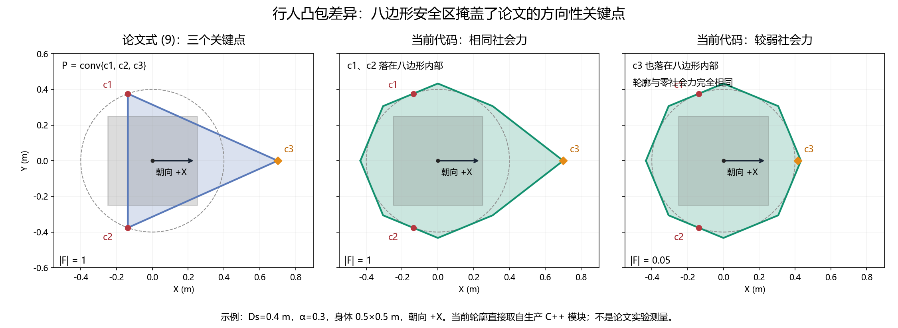

# DWCG 论文、汇报视频与 Planner 3 实现对照

核对日期：2026-10-27。代码基线：`f82830ad208a1a3ccbaf8934a910b81bd7334001`，分支 `mpc-lfpc-prototype`。

> 此文保留上述基线的审计结果。后续已实现的改动与参数见 [走廊使用说明](PLANNER3_CORRIDOR_USAGE.md)。

资料：

- Na et al., *Dynamic Walking Corridor Generation for Visually Impaired Navigation Using Social Force Models and Convex Optimization*, IROS 2025，DOI：10.1109/IROS60139.2025.11247206。下文页码为 PDF 页码，共 6 页。
- 用户提供的 `video_改.pptx`，共 6 页；核对了文字、方法图和 6 段内嵌视频的抽样画面。
- 当前生产 C++ 源码，以及直接调用 `PedestrianPolygon` 的独立几何实验。

本文记录分析与建议，未修改运行算法，未进行新的闭环导航或人群性能实验。

## 主要结论

当前实现保留了论文的 **A* 空间参考路径 → 行人凸包 → FIRI 凸走廊** 主框架，FIRI 中也确实存在凸优化步骤。主要差距来自进入 FIRI 的几何与行为模型：

| 对比项 | 论文 / PPT | 当前 Planner 3 | 对效果的影响 |
| --- | --- | --- | --- |
| 行人凸包 | 朝向 ±110° 两点，加社会力方向一点的三点凸包 | 身体矩形、完整安全圆的外接八边形、论文关键点共同取凸包 | 朝向关键点永远被八边形包含；弱力也可能不改变轮廓 |
| 社会力 | 期望速度驱动、人与人、边界及人杖交互；220° FOV | 最近边界斥力与系统中心斥力，FOV 内放大 | 难以出现论文中由群体互动产生的方向性几何变化 |
| 人杖几何 Q | 两个偏置安全圆的八点凸包；要求 Q 包含于可行域 | 空间走廊检查 CoM 点，另有静态足点检查；动态 SAT 使用 CoM 圆形包络 | 尚未落实完整人杖形状随姿态变化的约束 |
| 人群数量 | 25 / 50 / 75 / 100 人 | 输入及 FIRI 均限制至多 1 人 | 无法直接复现 PPT 多人实验 |
| 走廊采样 | 根据当前凸区域连续覆盖路径的最远位置选择下一采样点 | 逐原始 A* 边生成区域，必要时细分，再连接、验证、剪枝 | 生成开销、重叠和区域分布会不同 |
| 动态时间处理 | 明确随观测变化；具体未来时间索引未充分定义 | 当前凸包构造空间走廊；额外 CV 外推 + LFPC 同时刻 SAT | 当前有时间同步避障扩展，但不等于未来走廊序列 |

最优先应修正方向性行人几何及其可视化，再补足社会力输入与多行人支持。A* 参考与 FIRI 主体可以保留。

## 1. 参考 A* 路径符合论文

PDF 第 5 页 V-A 明确写明：A* 在静态障碍环境中搜索的路径作为 DWCG 的输入 `r̄(l)`。算法 2 的参数 `l` 是空间路径参数。

当前 [planner_manager.cpp](../plan_manage/src/planner_manager.cpp) 从实际 CoM 连接到权威 A* 路径的投影点，然后截取前方约 `max(8 m, 2 × lookahead_dist)` 的路径作为参考（约第 1225–1252 行）。因此，“基于全局路径生成”本身并非与论文不符。

但论文算法 2 要求输入是 **feasible path**。若某段路径已经穿过当前必须排除的行人凸包，就不可能同时满足“完整包含该路径”和“避开该凸包”。论文没有充分解释这种情况下的参考修复、等待及闭环恢复策略。

当前 FIRI 预检整个局部参考，阻挡时返回 `DYNAMIC_REFERENCE_BLOCKED`，管理器尝试以同一凸包作为临时硬障碍重新搜索 A*；恢复失败则停止。它不会仅靠膨胀把一条穿过障碍的路径变成可行走廊。这也意味着约 8 m 参考中较远处的一次当前交叉，可能提前触发路线恢复或停止。

## 2. 核心几何差距：完整安全八边形掩盖了方向性

PDF 第 3–4 页算法 1、式 (5)–(9) 和图 3 定义：

```text
c1 = p + Ds · unit(theta + 110°)
c2 = p + Ds · unit(theta - 110°)
Dr = Ds + alpha · |F|
c3 = p + Dr · unit(angle(F))
P_social = conv{c1, c2, c3}
```

当前 [pedestrian_polygon.cpp](../path_searching/src/pedestrian_polygon.cpp) 的 `fromForce`（约第 37–55 行）则是：

1. 加入完整身体 AABB 的四个顶点。
2. 令 `Ds = max(safety_radius, 身体半尺寸向量的模)`。
3. 加入包住整个半径 Ds 圆盘的外接正八边形。
4. 对运动行人加入 ±110° 两点及受限的社会力延伸点。
5. 对上述所有点取凸包。

由于 c1、c2 位于半径 Ds 的圆周上，而八边形包含整个圆盘，**这两个点永远无法决定最终凸包的外轮廓**。固定社会力时，只要速度非零，旋转行人朝向也不会改变 `fromForce` 的凸包。朝向仍可能通过 FOV 改变上游社会力，但这种间接作用也可能被八边形掩盖。

当 c3 仍落在八边形内部时，非零社会力也不会改变轮廓。因此调节 FOV 增益或较弱的社会力，可能看不到任何几何变化。



图中身体为 0.5 × 0.5 m，Ds = 0.4 m，alpha = 0.3，朝向 +X；右两图的凸包顶点直接取自当前生产 C++ 模块。左图按论文公式构造，属于说明性示例，并非论文实验数据。另有可缩放的 [SVG](figures/DWCG_PAPER_HULL_COMPARISON.svg)。

### 独立几何验证

直接调用当前 `PedestrianPolygon::fromForce/build`，未启动或修改 ROS 节点。使用默认 Config，位置 (0,0)、身体 (0.5,0.5)，逐顶点比较容差 `1e-12`：

| 输入变化 | 实际结果 |
| --- | --- |
| 速度 (1,0)，力从 (0,0) 改为 (0.05,0) | 凸包完全相同，均为 8 个顶点 |
| 力固定 (1,0)，速度从 (1,0) 改为 (0,1) | 凸包完全相同 |
| 速度为 0，力从 (0,0) 改为 (3,0) | 凸包完全相同 |
| 空网格中，系统在 (-2,0)，速度 +X 改为 -X，使系统进入 FOV | 力模由 0.0407622039784 变为 0.0815244079567，凸包仍完全相同 |

最后一项采用原点 (-5,-5)、分辨率 0.1 m、100 × 100 的空网格。由于系统距离 2 m 在 3 m 影响范围内，FOV 增益 2 生效；两个延伸点仍位于安全八边形内部。

零力凸包面积约 0.530193359838 m²。沿 +X 的八边形顶点为 `0.4 / cos(pi/8) ≈ 0.43295688 m`；弱力示例的 c3 仅为 `0.4 + 0.3 × 0.05 = 0.415 m`，所以被包含。

另一个明确差异：当前速度不超过 `1e-6 m/s` 时完全跳过朝向点和力延伸点，即使存在非零社会力也保持对称。现有 `StationaryIsSymmetricRegardlessOfForce` 测试有意固定了这一行为。Observation 也没有独立朝向，静止行人的朝向无法传入这个模块。

## 3. 当前社会力是简化近似

PDF 第 3 页式 (3)、IV-A 及算法 1 描述了期望速度驱动力、行人间斥力、边界斥力以及吸引/随机项的一般模型；`CALCULATESOCIALFORCE` 使用行人存储信息、静态障碍和人杖系统状态，并引入 220° FOV 内增强交互。论文没有提供所有项的完整工程参数与离散实现。

当前 `PedestrianPolygon::build`（约第 59–110 行）只实现：

- 最近一个阻塞栅格面或裁剪域边界的斥力。
- 人杖系统 CoM 点的各向同性斥力；系统在行人 ±110° FOV 内时乘以增益。
- 力模、延伸距离、影响距离与计算时间的限制。

当前接口没有行人 ID、历史状态或独立期望速度；将期望速度等同观测速度，驱动力为零。没有其他行人的相互作用，没有 SFM 状态时间积分，也没有吸引与随机项。指数采用 `exp(min(0, (Ds-distance)/decay))`，在近距离被限制为不超过 1，再叠加最终力上限。

另外，裁剪网格边界也会贡献斥力，靠近裁剪边缘时可能影响社会力方向。这是数值域带来的工程行为，未必对应真实墙面。

仿真端用 pedsim 产生社会力运动，并不意味着规划器内部也实现了论文的社会力凸包计算。两层应分别核对。

## 4. 人杖整体 Q 尚未对应论文

PDF 第 2 页 III-A、图 1 及第 3 页式 (2) 使用两个偏置安全圆的八点凸包 Q 表示整个人杖系统，并要求 `Q ⊆ C`。

当前空间走廊保护的是参考点/线段；LFPC rollout 检查 CoM 点位于走廊并保留静态足点检查。动态检查在 [timed_pedestrian_collision.cpp](../path_searching/src/timed_pedestrian_collision.cpp) 约第 34–38 行构造以 CoM 为中心的圆形外接八边形，默认半径 0.25 m，没有对应整个人杖的偏置长度与姿态旋转。

地图膨胀和中心包络提供工程余量，但不能直接视为已经验证论文的 `Q ⊆ C`。完整人杖几何需要独立设计和实验标定，不能仅更换行人三角形就声称完成。

## 5. 多人实验当前无法复现

PDF 表 I 包含 25、50、75、100 人；PPT 第 5 页展示 25、50、100 人。

当前两处显式限制：

- `PlannerManager::receivePedestrians`，约第 1802 行：`msg->num > 1` 直接判为无效。
- `ConvexCorridor::buildStatic`，约第 428 行：要求 `dynamic.size() <= 1`。

路线恢复同样按单一凸包接口实现。支持多人需要同步检查输入契约、社会力、FIRI、多障碍恢复、计算预算与可视化；仅放宽数量上限不足以复现论文行为。

## 6. FIRI 内核存在，外围策略与论文不同

当前 [convex_corridor.cpp](../path_searching/src/convex_corridor.cpp) 有真实的约束分离与最大体积内接椭圆 MVIE 步骤；`mvie` 使用 NLopt SLSQP，目标为负对数行列式。每个区域默认进行 4 轮分离/椭圆更新，完整静态单元和完整动态凸包都接受分离验证。它并非只画固定矩形。

论文算法 2 先在路径上采样，再取当前区域对路径的最远连续覆盖位置生成后续区域；正文还提到上一解初始化及自适应采样，但细节不足。

当前逐原始 A* 边生成区域，长于默认 1 m 的边再细分，保护两端点；随后检查重叠、必要时加入连接区域，并以解析路径覆盖验证剪枝。每个新区域的初始椭圆都是 `L = 0.05 I`，没有跨帧复用上一解。局部区域默认受 ±3 m 边界限制，路径是约 8 m 的局部前缀。

因此区域数量、重叠、画面范围与计算开销会不同。当前障碍使用完整阻塞栅格，论文描述以点云/凸几何为主，也会改变边界细节。这些差异应在统一输入条件下测量，优先级低于方向性凸包和社会力缺项。

FIRI 的迭代体积扩张也不提供全局最大多边形面积的证明。

## 7. “动态”与未来时间索引应分开解读

论文明确讨论预测、time-varying SWC 和时空解耦；但算法 1 没有给出未来时间序列的积分规则，算法 2 使用空间参数 `l`，没有定义供每个轨迹时刻查询的 `C(t+tau)` 序列。因此可以确认“根据变化的行人状态反复更新走廊”，却无法仅凭该文完整还原“未来每个时刻一个走廊”的实现。

当前 FIRI 排除当前观测生成的凸包；额外的 LFPC 时间同步检查则以

```text
P(t+tau) = P0 + v × (observation_age + tau)
```

平移同一已接受凸包，并与对应 LFPC 时刻的 CoM 包络进行 SAT 相交检查，还保留执行前重新验证。这是有价值的附加机制，但没有让 FIRI 本身变成未来时间索引的走廊生成器。应保留这层检查，同时明确匀速、形状固定和离散样本的适用范围。

## 8. PPT 和论文实验的证据范围

PPT 第 3 页重申人杖几何、SFM 行人几何、静态障碍经 FIRI 生成 SWC。第 4 页三段视频及第 5 页三段人群视频中，抽样画面可见走廊随行人移动改变形状。这支持动态几何适应的展示，无法单独证明完整人杖闭环导航成功率、未来时刻匹配或连续时间避碰。

论文报告的是 **走廊生成** 性能：

| 人数 | 平均耗时 | 最差耗时 | 表 I 成功率 |
| --- | --- | --- | --- |
| 25 | 6.2 ms | 8.9 ms | 100% |
| 50 | 10.1 ms | 13.1 ms | 100% |
| 75 | 13.8 ms | 16.1 ms | 100% |
| 100 | 30.6 ms | 78.1 ms | 85.3% |

其中 100 人成功率存在资料内不一致：摘要为 86.3%，表 I 与正文为 85.3%，PPT 表格为 86.30%。引用时应注明。上述数据不能直接与当前单行人 MPPI 优化耗时比较，也不能作为导航到达成功率。

## 9. 建议的实施顺序

### 第一阶段：让方向性几何可解释、可验证

分别定义身体硬安全核 B 与论文方向性社会空间 `P_social`，然后构造明确覆盖身体的避障凸包，例如 `conv(B ∪ P_social)`。B 的形状和最小余量需要独立选择；如果 B 仍覆盖整个半径 Ds 圆盘，±110° 点依然会被包含。

不能直接删除身体覆盖并照搬三点公式：朝向 +X 时 c1、c2 的 x 坐标为 `Ds cos(110°) < 0`；若合力朝 -X，c3 的 x 也为负，整个三角形会排除行人中心。零合力的方向也需要单独定义。论文图示与公式未完整解决这些边界情况。

RViz 建议同时显示身体核、原始社会三角形、实际避障凸包、社会力箭头与 FOV；相同输入下分别观察朝向、FOV 和力大小的影响。验证覆盖身体、反向力、零速零力、数值有效性及预算，再比较走廊效果。

### 第二阶段：补足模型输入和多人交互

引入可追踪的行人状态、独立朝向和合理的期望速度来源；实现确定性的驱动力、人与人斥力及边界/系统交互，明确使用哪些 SFM 项。随机项应在确有需要时引入，并说明复现方式。随后完善多行人 FIRI、恢复与计算预算，以三类交互和逐级人数实验验证。

### 第三阶段：完整人杖几何与效率

把随姿态变化的 Q 及空间约束、动态碰撞检查统一起来；再评估按覆盖范围推进的采样、上一解初始化和障碍查询成本，保留现有覆盖及分离证据。

未来时间索引走廊可作为另一个研究扩展单独定义，避免把论文未给出的细节当作已经确定的复现要求。现有 CV/SAT、数据时效与失败停止机制应贯穿上述改动。
